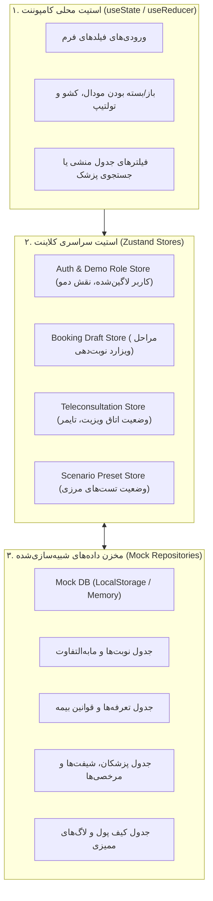

# معماری، استک فنی و طراحی ماژولار فرانت‌اند (Frontend Architecture) — نسخهٔ ۱.۰

**وضعیت سند:** معتبر برای فاز ۲ (طراحی چرخهٔ ساخت و ارزیابی فرانت)  
**سند بالادستی مرجع:** `prd.md` و `docs/frontend-spec.md`  
**ماهیت سند:** این سند معماری فنی، ساختار درختی کاتالوگ، تفکیک دامنه‌ها (Feature Boundaries)، مدیریت استیت و سازوکار شبیه‌سازی بدون بک‌اند را مشخص می‌کند.

---

## ۱. انتخاب استک فنی و توجیه نگهداری‌پذیری

با توجه به این‌که کارفرما فاقد تیم فنی داخلی است و تحویل سورس باید با حداکثر سادگی، سبکی و خوانایی همراه باشد، از فریم‌ورک‌های پیچیده که نیازمند سرور Node.js یا زیرساخت پیچیدهٔ SSR هستند اجتناب شده است:

| لایه / ابزار | فناوری انتخاب‌شده | دلیل انتخاب و مزیت در چرخهٔ ارزیابی و تحویل |
| --- | --- | --- |
| **هستهٔ فرانت‌اند** | **React 18 / 19 + TypeScript** | استاندارد پایدار وب، تایپ‌سیف بودن تمامی مدل‌های داده‌ای بیمه و مالی، سهولت نگهداری برای هر تیم برنامه‌نویسی در آینده. |
| **ابزار ساخت (Bundler)** | **Vite** | راه‌اندازی سریع (HMR فوری)، ساختار سبک، بدون نیاز به سرور پیچیده، خروجی بهینه و اجرای ایزوله در محیط محلی. |
| **استایل‌دهی و طراحی** | **Tailwind CSS (RTL-First)** | پشتیبانی استاندارد از راست‌چین (RTL) زبان فارسی، واکنش‌گرایی منعطف روی موبایل و دسکتاپ، حجم نهایی بسیار کم (Purged CSS). |
| **کتابخانه کامپوننت پایه** | **Radix UI Primitives + Lucide Icons** | کامپوننت‌های بدون استایل و دسترس‌پذیر (Accessible) برای مودال‌ها، تب‌ها، کشوها و پاپ‌اورها، همراه با آیکون‌های وکتور تمیز و سبک. |
| **پشتیبانی PWA** | **vite-plugin-pwa** | پاسخ به شرط S6 بستهٔ محصول؛ امکان نصب روی صفحهٔ اصلی موبایل (A2HS)، کش دارایی‌ها و رفتار شبه‌اپلیکیشن بدون نیاز به استورها. |
| **تقویم و تاریخ فارسی** | **date-fns-jalali** | پردازش دقیق و سبک تاریخ خورشیدی برای تقویم ویزیت و شیفت‌های پزشکی بدون باگ سال کبیسه. |
| **پردازش اکسل در کلاینت** | **xlsx (SheetJS)** | خواندن و استخراج شیت‌های ۱ و ۲ اکسل تعرفه به‌صورت مستقیم در مرورگر بدون نیاز به پردازش بک‌اند. |
| **مدیریت State کلاینت** | **Zustand** | استورهای ساده، بدون Boilerplate، بسیار خوانا، با پشتیبانی طبیعی از DevTools و ذخیرهٔ اختیاری در LocalStorage. |
| **لایه شبیه‌سازی داده** | **In-Memory Mock Repository + LocalStorage** | ایزولاسیون کامل از سرور واقعی؛ امکان راه‌اندازی صفر تا صد با یک دستور و ریست داده‌ها به وضعیت اولیه. |

---

## ۲. ساختار دایرکتوری و مرز Featureها (Feature-Sliced Directory Structure)

ساختار پروژه بر اساس تفکیک دامنه‌های عملکردی (Domain-Driven Features) تنظیم شده است تا توسعه و آزمون هر جریان کاملاً مستقل باشد:

```text
src/
├── app/                                 # پیکربندی روت‌ها، پرووایدرها و لی‌آوت اصلی
│   ├── routes.tsx                       # تعریف مسیرهای پورتال بیمار، منشی، پزشک، مالی
│   ├── providers.tsx                    # پرووایدرهای تم، اعلان و استور
│   └── layout/                          # لی‌آوت واکنش‌گرا با نوار سوییچ نقش دمو
│
├── features/                            # دامنه‌های عملکردی مستقل (Features)
│   ├── auth-profile/                    # ورود با موبایل، کد ملی، OTP و رضایت‌نامه (FLOW-01)
│   │   ├── components/                  # LoginForm, ConsentModal, RoleSwitcher
│   │   └── hooks/                       # useAuth, useRole
│   │
│   ├── booking/                         # جریان رزرو نوبت و انتخاب تقویم (FLOW-02)
│   │   ├── components/                  # BranchSelect, ServiceSelect, CalendarSlotPicker
│   │   └── hooks/                       # useBookingWizard
│   │
│   ├── insurance-engine/                # موتور محاسبهٔ پلکانی بیمه پایه و تکمیلی (INT-01)
│   │   ├── logic/                       # calculateInsurance.ts (هستهٔ محاسبات ریاضی)
│   │   └── components/                  # InsuranceSelector, PriceBreakdownTable
│   │
│   ├── payment-mock/                    # شبیه‌ساز درگاه بانکی شاپرک (INT-03)
│   │   ├── components/                  # GatewaySimulator, PaymentResultView
│   │   └── hooks/                       # usePaymentSimulation
│   │
│   ├── secretary/                       # پذیرش، اصلاح بیمه و مهار مانده‌حساب (FLOW-03, SCREEN-05)
│   │   ├── components/                  # AppointmentTable, InsuranceEditModal, EmergencyUnlockDialog
│   │   └── hooks/                       # useSecretaryActions
│   │
│   ├── teleconsultation/                # اتاق ویزیت زنده و وب‌آرتی‌سی شبیه‌سازی‌شده (FLOW-04, SCREEN-06)
│   │   ├── components/                  # VideoRoom, CallControls, DocumentGalleryLightbox
│   │   └── hooks/                       # useMockWebRTC, useCallTimer
│   │
│   ├── clinical-notes/                  # فرم شرح‌حال ۵ فیلدی و Field-Level RBAC (FLOW-04)
│   │   ├── components/                  # FiveFieldNoteForm, NoteAuditLog
│   │   └── hooks/                       # useClinicalNotes
│   │
│   ├── calendar-shifts/                 # مدیریت تقویم شیفت‌ها و مرخصی (FLOW-05)
│   │   ├── components/                  # ShiftScheduleGrid, LeaveRequestModal
│   │   └── hooks/                       # useShiftCalendar
│   │
│   ├── financial-dashboard/             # اکسل ۲ شیتی با Diff و گزارش سهم پزشک (FLOW-06, SCREEN-07)
│   │   ├── components/                  # ExcelUploaderDiff, FinancialKPICards, DoctorShareReport
│   │   ├── logic/                       # excelParser.ts, doctorShareCalculator.ts
│   │   └── hooks/                       # useTariffUpload
│   │
│   └── patient-portal/                  # داشبورد بیمار، نسخه و کیف پول (FLOW-02, SCREEN-04)
│       ├── components/                  # AppointmentCard, PatientWallet, RescheduleModal
│       └── hooks/                       # usePatientAppointments
│
├── mocks/                               # لایه داده و خدمات شبیه‌سازی‌شده (بدون بک‌اند)
│   ├── db/                              # دیتابیس حافظه‌ای با ذخیره‌سازی در LocalStorage
│   │   ├── seedData.ts                  # داده‌های اولیهٔ شعب تهران و اصفهان، پزشکان، تعرفه‌ها
│   │   └── memoryDb.ts                  # موتور CRUD و تراکنش‌های داخلی شبیه‌سازی‌شده
│   ├── repositories/                    # پیاده‌سازی اینترفیس‌های مخزن داده
│   │   ├── appointmentRepository.ts     # مخزن نوبت‌ها، وضعیت‌ها و لاگ‌ها
│   │   ├── doctorRepository.ts          # مخزن پزشکان، شیفت‌ها و درخواست‌های مرخصی
│   │   ├── tariffRepository.ts          # مخزن تعرفه‌ها و شیت‌های اکسل
│   │   └── walletRepository.ts          # مخزن کیف پول و تراکنش‌های بدهکار/بستانکار
│   ├── webrtc/                          # کنترلر شبیه‌ساز تماس ویدیویی
│   │   └── mockMediaStream.ts           # تولید استریم ویدیویی ساختگی یا اتصال به Loopback
│   └── scenario/                        # کنترلر تزریق سناریوهای مرزی ارزیابی
│       └── scenarioPresets.ts           # تنظیمات پیش‌ساخته: بیمار بدهکار، اینترنت ضعیف، اکسل خطا
│
├── shared/                              # ابزارها، مدل‌ها و کامپوننت‌های عمومی
│   ├── ui/                              # دکمه، کارت، تگ، مدال، ورودی، دراور
│   ├── types/                           # تایپ‌های عمومی دامنه (Appointment, Doctor, Tariff, ...)
│   └── utils/                           # فرمت عدد ریال/تومان، تاریخ جلالی، سنجش کد ملی
│
├── tests/                               # پوشه تست‌های اعتبارسنجی
│   ├── logic/                           # تست‌های واحد منطق ریاضی و مالی (Vitest)
│   └── browser/                         # سناریوهای مرورگری جریان‌های کاربری (Playwright / Vitest Browser)
```

---

## ۳. تفکیک و مالکیت State (State Ownership & Flow)

برای جلوگیری از پراکندگی داده و ناهماهنگی وضعیت، استیت‌ها در سه سطح شفاف دسته‌بندی شده‌اند:



1. **Local State:**  
   منحصراً متعلق به کامپوننت است (مثل متن تایپ‌شده در کادر جستجوی پزشک، تب فعال در صفحهٔ ویزیت، یا باز بودن مودال لغو).
2. **Global Client State (Zustand):**  
   حفظ وضعیت‌های فرآیندی که بین صفحات به اشتراک گذاشته می‌شوند:
   * `useAuthStore`: توکن ساختگی، مشخصات کاربر جاری، و سوییچ نقش فعال دمو.
   * `useBookingStore`: ذخیرهٔ موقت گام‌های ۱ تا ۴ رزرو تا زمان قطعی شدن پرداخت.
   * `useTeleconsultationStore`: اتصال ویدیویی، فعال بودن وب‌کم، لاگ زمان مکالمه.
3. **Mock Data Layer (مخزن شبیه‌سازی‌شده):**  
   جایگزین دیتابیس واقعی؛ تغییر وضعیت نوبت به `CONFIRMED`، اصلاح سهم بیمه، ثبت لاگ اضطراری منشی، و ذخیرهٔ یادداشت بالینی ۵ فیلدی مستقیماً در این لایه انجام شده و با LocalStorage همگام می‌شود تا با رفرش صفحه اطلاعات از دست نرود.

---

## ۴. استراتژی شبیه‌سازی صریح و کنترل‌پذیر (Deterministic Mock Engine)

به دلیل ممنوعیت اتصال به بک‌اند واقعی، دیتابیس، درگاه پرداخت یا پنل پیامک در این چرخه، سازوکارهای شبیه‌سازی زیر در سیستم تعبیه می‌شوند:

### ۴.۱ شبیه‌ساز درگاه بانکی شاپرک (`payment-mock`)
* کامپوننت شبیه‌ساز یک صفحهٔ کامل پرداخت شبیه به درگاه‌های الکترونیک بانکی (به‌نام کلینیک) را رندر می‌کند.
* کنترل‌های ارزیابی شامل:
  * دکمهٔ «پرداخت موفق»: صدور شماره ارجاع ساختگی و بازگشت موفق به فرانت.
  * دکمهٔ «موجودی ناکافی»: تولید خطای پرداخت و امکان تلاش مجدد.
  * دکمهٔ «انصراف کاربر»: بازگشت به سبد با حفظ مشخصات قبلی.

### ۴.۲ شبیه‌ساز WebRTC و ویزیت ویدیویی (`teleconsultation-mock`)
* بدون نیاز به هیچ‌گونه سرور خارجی STUN/TURN یا سرویس‌های پولی:
  * در صورت داشتن وب‌کم و اجازهٔ کاربر: استفاده از `navigator.mediaDevices.getUserMedia` برای نمایش تصویر محلی در کادر تصویر با افکت‌های تصویری.
  * در غیاب وب‌کم یا محیط تست بدون تصویر: استفاده از یک ویدیو استریم ساختگی (Canvas Stream متحرک شبیه‌سازی‌شده) تا کل رابط کاربری تماس و تایمر معکوس ۱۲–۱۵ دقیقه کاملاً بدون خطا کار کند.

### ۴.۳ پنل ناظر سناریو و کنترل ارزیابی (Demo & Scenario Toolbar)
* در بالای تمام صفحات یک نوار کنترل شناور (قابل جمع شدن) تعبیه می‌شود که به ارزیاب اجازه می‌دهد:
  1. با ۱ کلیک نقش خود را به **بیمار**، **منشی شعبه تهران**، **منشی شعبه اصفهان**، **پزشک** یا **ادمین مالی** تغییر دهد.
  2. وضعیت «بیمار بدهکار» را شبیه‌سازی کرده و اثر قفل نرم را مشاهده کند.
  3. وضعیت «اکسل نامعتبر با ستون ناقص» را برای تست اعتبارسنجی آپلود تست کند.
  4. دکمهٔ «ریست کامل داده‌ها به وضعیت اولیه (Factory Reset)» برای پاک‌سازی تست‌ها و شروع مجدد.

---

## ۵. ماتریس جهت بصری و طراحی واکنش‌گرا (RTL & Responsive Matrix)

* **جهت بصری:** صد درصد راست‌چین (`dir="rtl"`) با فونت فارسی استاندارد (مانند Vazirmatn / Shabnam).
* **واکنش‌گرایی بر اساس دستگاه:**
  * **موبایل (بیمار - پورتال و رزرو):** طراحی Mobile-First؛ رزرو به صورت مراحل کارت‌محور با ناوبری پایین صفحه (Bottom Navigation) و دکمه‌های بزرگ لمسی تا زیر ۳ دقیقه انجام شود.
  * **دسکتاپ/تبلت (منشی - SCREEN-05):** جدول متراکم داده‌ها، فیلترهای سریع شعبه، کشوی جانبی جهت مشاهده سریع مدارک و فرم اصلاح بیمه بدون ترک صفحه.
  * **دسکتاپ/تبلت عریض (پزشک - SCREEN-06):** چیدمان دوتکه (Side-by-Side)؛ ویدیوی ویزیت در یک سمت و مدارک به همراه ۵ فیلد متنی در سمت دیگر، تا پزشک نیاز به جابجایی بین تب‌ها در ویزیت ۱۲–۱۵ دقیقه‌ای نداشته باشد.
  * **دسکتاپ (مالی - SCREEN-07):** پیش‌نمایش جدول مقایسه‌ای اکسل و نمودارهای آماری تجمیعی.
