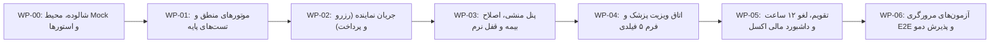

# برنامهٔ اجرایی و بسته‌های کاری فرانت‌اند (Frontend Execution Plan) — نسخهٔ ۱.۰

**وضعیت سند:** معتبر برای فاز ۲ (طراحی چرخهٔ ساخت و ارزیابی فرانت)  
**سند بالادستی مرجع:** `prd.md`، `docs/frontend-spec.md`، `docs/frontend-architecture.md` و `docs/frontend-test-plan.md`  
**ماهیت سند:** ساختار شکست کار (WBS)، بسته‌های کاری مبتنی بر جریان، و تفکیک وظایف آماده به اجرا از موارد منتظر تصمیم.

---

## ۱. ساختار شکست کار مبتنی بر جریان‌ها (Flow-Based WBS)

برای پیشبرد منظم نمونهٔ آزمایشی فرانت‌اند بدون وابستگی به سرور، کارها در ۶ بستهٔ کاری اصلی (Work Packages) تعریف شده‌اند:

---

## ۲. مشخصات بسته‌های کاری و مراحل پیاده‌سازی

### بستهٔ کاری WP-00: شالوده، محیط شبیه‌ساز داده و نوار ابزار دمو
* **هدف:** راه‌اندازی پروژه با Vite، Tailwind RTL، استورهای Zustand، دیتابیس حافظه‌ای LocalStorage و ویجت سوییچ نقش.
* **اقدامات اجرایی:**
  1. مقداردهی اولیهٔ پروژهٔ React 19 + TypeScript با Vite.
  2. پیکربندی Tailwind CSS با متغیرهای رنگی، فونت فارسی و استایل‌های راست‌چین (`dir="rtl"`).
  3. پیاده‌سازی `mocks/db/seedData.ts` شامل داده‌های پایهٔ دو شعبه (تهران و اصفهان)، ۴ پزشک، تعرفه‌های خدمات و شرکت‌های بیمه.
  4. پیاده‌سازی `mocks/db/memoryDb.ts` جهت مدیریت CRUD و ماندگاری تغییرات در LocalStorage.
  5. ساخت کامپوننت شناور `RoleSwitcherToolbar` برای تعویض بلادرنگ کاربر به بیمار، منشی تهران، منشی اصفهان، پزشک و مدیر مالی با کلید «ریست کارخانه‌ای داده‌ها».
* **خروجی:** اسکلت کامل پروژه با امکان جابجایی بین نقش‌ها و دیتابیس لوکال آماده.

### بستهٔ کاری WP-01: پیاده‌سازی موتورهای منطق خالص و تست‌های Vitest
* **هدف:** تضمین صحت صددرصدی الگوریتم‌های مالی و ریاضی پیش از اتصال به UI.
* **اقدامات اجرایی:**
  1. پیاده‌سازی تابع `calculateInsurance(service, baseIns, suppIns)` بر مبنای فرمول پلکانی بند ۹.۱ سند `prd.md`.
  2. پیاده‌سازی تابع `calculateDoctorShare(grossAmount, consumables, docPercent, taxPercent)` بر مبنای بند ۹.۱ سند `prd.md`.
  3. پیاده‌سازی تابع `evaluateCancellation(appointmentTime, cancelTime, cancelledBy)` با قاعدهٔ مرز ۱۲ ساعت و ۵۰٪ جریمه.
  4. نگارش و اجرای ۱۰ تست واحد منطق (`TEST-LOGIC-01` تا `TEST-LOGIC-10`) در `tests/logic/`.
* **خروجی:** موتورهای مالی تاییدشده با گزارش قبولی ۱۰۰٪ تست‌های واحد Vitest.

### بستهٔ کاری WP-02: جریان نماینده — رزرو نوبت، پرداخت و کیف پول (FLOW-02)
* **هدف:** ایجاد تجربهٔ نوبت‌گیری آنلاین، محاسبهٔ لحظه‌ای بیمه و پرداخت شبیه‌سازی‌شده در کمتر از ۳ دقیقه.
* **اقدامات اجرایی:**
  1. پیاده‌سازی فرم ویزارد ۴ مرحله‌ای `features/booking/` (انتخاب شعبه/خدمت $\rightarrow$ انتخاب پزشک/تقویم $\rightarrow$ انتخاب بیمه $\rightarrow$ پیش‌فاکتور).
  2. اتصال ورودی‌های فرم به موتور `calculateInsurance` و نمایش ریز اقلام مالی (سهم پایه، سهم تکمیلی، کسر از بستانکاری قبلی).
  3. پیاده‌سازی ماژول آپلود مدارک پزشکی کلاینت با پیش‌نمایش تصویر و سنجش حجم.
  4. پیاده‌سازی صفحهٔ شبیه‌ساز درگاه شاپرک (`payment-mock`) با دکمه‌های پرداخت موفق/ناموفق/انصراف.
  5. صدور فوری شناسهٔ پیگیری یکتا، ثبت نوبت با وضعیت `CONFIRMED` و نمایش کارت نوبت در داشبورد بیمار (`features/patient-portal/`).
* **خروجی:** چرخهٔ کامل رزرو آنلاین بیمار از آغاز تا صدور فاکتور قطعی.

### بستهٔ کاری WP-03: میز کار منشی، اصلاح دستی بیمه و قفل نرم بدهکاری (FLOW-03)
* **هدف:** توانمندسازی منشی برای بررسی مدارک، اصلاح سهم بیمه، مدیریت مانده‌حساب و کنترل اضطراری ویزیت.
* **اقدامات اجرایی:**
  1. طراحی جدول نوبت‌های روز به تفکیک شعبه (تهران/اصفهان) و نوع نوبت (حضوری/آنلاین).
  2. ساخت کشوی نمایش مدارک آپلودشدهٔ بیمار با امکان زوم تصویر.
  3. پیاده‌سازی مودال اصلاح بیمه همراه با محاسبهٔ بلادرنگ دلتا ($\Delta$):
     * در صورت $\Delta > 0$: افزایش بستانکاری در کیف پول بیمار.
     * در صورت $\Delta < 0$: ثبت بدهکاری روی نوبت و حساب بیمار.
  4. فعال‌سازی مکانیزم قفل نرم (Soft Lock) روی دکمهٔ ورود به جلسهٔ ویدیویی بیمار در صورت وجود بدهی.
  5. پیاده‌سازی دیالوگ «بازگشایی اضطراری قفل ورود» در پنل منشی همراه با الزام ثبت متن دلیل در لاگ ممیزی.
* **خروجی:** کنترل کامل نوبت‌ها توسط منشی و آزمون‌پذیری سناریوی بدهکاری و قفل نرم.

### بستهٔ کاری WP-04: کارتابل پزشک، اتاق ویزیت زنده و فرم شرح‌حال ۵ فیلدی (FLOW-04)
* **هدف:** برگزاری مشاورهٔ ویدیویی بدون ضبط، فرم ثبت یادداشت بالینی، و تفکیک دسترسی فیلدها.
* **اقدامات اجرایی:**
  1. طراحی چیدمان دوتکه (Side-by-Side) برای پزشک: تصویر ویدیویی در یک سمت و تب‌های مدارک/شرح‌حال در سمت دیگر.
  2. شبیه‌سازی ارتباط ویدیویی با استفاده از استریم وب‌کم محلی یا استریم ساختگی متحرک همراه با تایمر معکوس ۱۲–۱۵ دقیقه و دکمه‌های قطع صدا/تصویر.
  3. ساخت فرم متنی ساده شامل ۵ فیلد استاندارد: شکایت اصلی، یافته‌ها/معاینه، تشخیص، توصیه‌ها و نسخه، دستور پیگیری.
  4. پیاده‌سازی قانون محرمانگی Field-Level RBAC:
     * در پنل بیمار: فقط فیلدهای «توصیه‌ها و نسخه» و «دستور پیگیری» رندر شوند.
     * در پنل منشی: فقط فیلد «دستور پیگیری» رندر شود.
     * در پنل پزشک: هر ۵ فیلد با امکان ویرایش در دسترس باشند.
* **خروجی:** جلسهٔ ویزیت آنلاین عملیاتی و پروندهٔ بالینی با رعایت محرمانگی پزشکی.

### بستهٔ کاری WP-05: تقویم شیفت‌ها، مرخصی و ماژول مالی اکسل ۲ شیتی (FLOW-05, FLOW-06)
* **هدف:** هماهنگی ظرفیت تقویم، اعمال قانون لغو ۱۲ ساعت، و پردازش اکسل تعرفه.
* **اقدامات اجرایی:**
  1. پیاده‌سازی تقویم هفتگی شیفت پزشکان به تفکیک شعبه تهران، اصفهان و آنلاین.
  2. پیاده‌سازی فرم ثبت درخواست مرخصی پزشک و تایید توسط منشی ارشد.
  3. پیاده‌سازی دیالوگ لغو نوبت توسط بیمار با اعتبارسنجی فاصلهٔ زمانی:
     * فاصله $\ge 12$ ساعت: لغو رایگان و واریز ۱۰۰٪ به کیف پول.
     * فاصله $< 12$ ساعت: کسر ۵۰٪ جریمه کلینیک و واریز ۵۰٪ به کیف پول.
  4. پیاده‌سازی کامپوننت آپلود فایل اکسل ۲ شیتی با تحلیلگر SheetJS و نمایش جدول مقایسه‌ای پیش‌نمایش تفاوت‌ها (Diff Preview) قبل از ذخیره.
  5. داشبورد مالی ادمین: نمایش درآمد کل، سهم پزشکان بر اساس فرمول مصوب، و مبالغ بدهکار/بستانکار.
* **خروجی:** تقویم کاری هماهنگ و پنل مالی مجهز به تحلیلگر اکسل ۲ شیتی.

### بستهٔ کاری WP-06: آزمون‌های مرورگری E2E و آماده‌سازی سشن ارزیابی
* **هدف:** اجرای تست‌های مرورگری خودکار برای تمامی جریان‌ها و فراهم‌سازی دموی یکپارچه.
* **اقدامات اجرایی:**
  1. پیاده‌سازی سناریوهای تست مرورگری در `tests/browser/` (شامل جریان نماینده، قفل نرم، شرح‌حال و آپلود اکسل).
  2. ضبط و مستندسازی نتایج آزمون‌های خودکار.
  3. اعتبارسنجی شاخص زمان ثبت نوبت زیر ۳ دقیقه در سناریوی شبیه‌سازی‌شده.
* **خروجی:** بستهٔ کامل فرانت‌اند ارزیابی‌شده و آمادهٔ بررسی کارفرما.

---

## ۳. ثبت تصمیم‌های روشن‌شده و وضعیت آمادگی بسته‌های کاری

### ۳.۱ جدول تصمیم‌های مصوب فاز ۲ (تأییدیهٔ کارفرما/توسعه‌دهنده)

| شناسه | موضوع تصمیم | تصمیم معتبر مصوب | وضعیت | اثر بر پیاده‌سازی و ارزیابی |
| --- | --- | --- | --- | --- |
| **DEC-FE-01** | **نوار ابزار دمو و سناریو (Role & Scenario Toolbar)** | تصویب تعبیهٔ ویجت شناور بالای صفحه جهت سوئیچ بلادرنگ به ۵ نقش (بیمار، منشی تهران، منشی اصفهان، پزشک، ادمین)، دکمهٔ تزریق حالت بیمار بدهکار، و دکمهٔ ریست داده‌ها. | ✅ **تصویب شد** | پیاده‌سازی قطعی در `WP-00` جهت ارزیابی مستقل و بدون نیاز به لاگین مکرر. |
| **DEC-FE-02** | **شبیه‌ساز WebRTC و اتاق ویزیت** | تصویب استفاده از استریم وب‌کم محلی (Local Loopback) با استریم انیمیشن جایگزین در غیاب دوربین برای پوشش جلسهٔ ۱۲–۱۵ دقیقه و چیدمان Side-by-Side. | ✅ **تصویب شد** | پیاده‌سازی قطعی در `WP-04` بدون وابستگی به سرور خارجی STUN/TURN. |
| **DEC-FE-03** | **مقادیر اولیهٔ مالیات و فایل ماک اکسل** | تصویب اعمال درصد مالیات پیش‌فرض ۱۰٪ در فیلد تنظیمی پنل ادمین و ایجاد فایل اکسل نمونهٔ ۲ شیتی ماک مطابق جدول بند ۹.۲ سند مرجع جهت تست‌های diff و محاسبات. | ✅ **تصویب شد** | پیاده‌سازی قطعی در `WP-01` و `WP-05`؛ داده‌ها آمادهٔ تست بوده و در آینده به راحتی قابل تنظیم هستند. |

---

## ۴. ماتریس آمادگی کامل بسته‌های کاری (Ready for Execution)

با تصویب تصمیم‌های سه‌گانه، هیچ ابهام یا مانع تصمیمی برای شروع نمونه‌سازی وجود ندارد و تمامی بسته‌های کاری در وضعیت آماده به اجرا قرار دارند:

| وضعیت آمادگی / اجرا | بستهٔ کاری | دامنه و خروجی بسته | وضعیت و پیش‌نیاز |
| --- | --- | --- | --- |
| ✅ **تکمیل‌شده (کامیت 3dfc415)** | **WP-00: شالوده، محیط ماک و استورها** | پروژه React 19 + Vite، استورهای Zustand، دیتابیس حافظه‌ای و نوار دمو | اجرا و تست‌های پایه با موفقیت انجام شد |
| ✅ **تکمیل‌شده (WP-01)** | **WP-01: موتورهای منطق محاسباتی** | الگوریتم پلکانی بیمه، سهم پزشک (با مالیات ۱۰٪)، لغو ۱۲ ساعته و تست‌های واحد Vitest | ۱۰۰٪ تست‌های TEST-LOGIC-01 تا TEST-LOGIC-10 سبز شد |
| ✅ **تکمیل‌شده (WP-02)** | **WP-02: جریان نماینده رزرو و پرداخت** | ویزارد رزرو آنلاین زیر ۳ دقیقه، محاسبه بلادرنگ بیمه، شبیه‌ساز شاپرک و صدور کد قطعی نوبت | تست‌های مرورگری representativeBooking با موفقیت ۱۰۰٪ سبز شد |
| ✅ **تکمیل‌شده (WP-03)** | **WP-03: پنل منشی و قفل نرم** | جدول نوبت‌ها، اصلاح دستی سهم بیمه، دلتای کیف پول، بازگشایی اضطراری، بررسی مدارک با زوم و رعایت RBAC | تست‌های مرورگری secretaryInsuranceAndLock با موفقیت ۱۰۰٪ سبز شد |
| ✅ **تکمیل‌شده (WP-04)** | **WP-04: کارتابل پزشک، اتاق ویزیت و شرح‌حال ۵ فیلدی** | ویدیوی محلی Loopback، تایمر معکوس، فرم ۵ فیلدی و تفکیک محرمانگی Field-Level RBAC | تست‌های مرورگری teleconsultationAndRBAC با موفقیت ۱۰۰٪ سبز شد |
| ✅ **تکمیل‌شده (WP-05)** | **WP-05: تقویم، لغو نوبت و ماژول مالی اکسل** | تقویم شیفت‌ها، لغو ۱۲ ساعته با ۵۰٪ جریمه، و آپلود اکسل ۲ شیتی با Diff | ۱۰۰٪ تست‌های مرخصی، لغو نوبت، آپلود اکسل و داشبورد مالی سبز شد (۴۹ تست) |
| 🟢 **۱۰۰٪ آماده به اجرا** | **WP-06: آزمون‌های مرورگری E2E** | آزمون‌های مرورگری تکمیلی، اعتبارسنجی نهایی دمو و گزارش تجمیعی پذیرش | پیش‌نیاز (WP-05) تکمیل؛ منتظر صدور مجوز کاربر |

