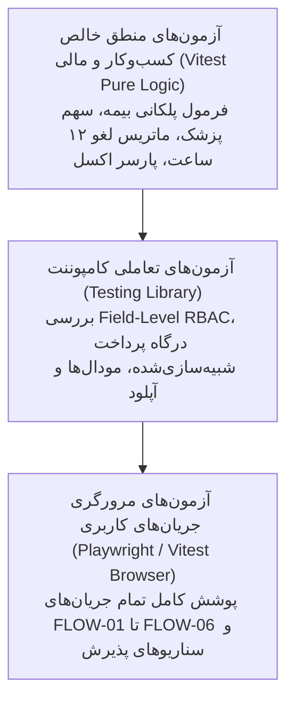

# طرح جامع آزمون و اعتبارسنجی فرانت‌اند (Frontend Test Plan) — نسخهٔ ۱.۰

**وضعیت سند:** معتبر برای فاز ۲ (طراحی چرخهٔ ساخت و ارزیابی فرانت)  
**سند بالادستی مرجع:** `prd.md`، `docs/frontend-spec.md` و `docs/frontend-architecture.md`  
**هدف:** تضمین انطباق ۱۰۰٪ رفتار پیاده‌سازی‌شده با تعریف رفتار مصوب بستهٔ مرجع، پوشش تمامی جریان‌ها با تست مرورگری، و آزمون دقیق قواعد پرترکیب ریاضی و مالی با تست‌های منطق.

---

## ۱. استراتژی هرم آزمون (Testing Pyramid & Scope)

| سطح آزمون | ابزار تست | محدوده و هدف | انتظار تست |
| --- | --- | --- | --- |
| **Logic Tests (تست منطق خالص)** | **Vitest** | الگوریتم پلکانی بیمه، فرمول سهم پزشک، ماتریس جریمهٔ لغو، پارسر فایل اکسل تعرفه. | اجرای سریع در صدم ثانیه، پوشش کامل حالات لبه (Edge Cases) و برابری عددی دقیق. |
| **Component Tests (آزمون کامپوننت)** | **React Testing Library** | اعتبارسنجی فرم‌ها، پنهان‌سازی فیلدهای محرمانه در DOM، رفتار درگاه شبیه‌ساز، آپلود مدارک. | اطمینان از عملکرد مستقل قطعات و رعایت سطوح دسترسی در سطح رندر. |
| **Browser E2E Tests (آزمون مرورگری)** | **Playwright / Browser Runner** | پیمایش مرورگری کل جریان‌های FLOW-01 تا FLOW-06 از دید کاربر نهایی با شبیه‌سازها. | انطباق کامل جریان نماینده (زیر ۳ دقیقه)، تست قفل نرم بدهکاری و چرخهٔ کامل ویزیت. |

---

## ۲. ماتریس آزمون‌های منطق پرترکیب (Logic Test Matrix)

تمامی تست‌های این بخش بر مبنای فرمول‌های قطعی بخش ۹ سند `prd.md` در فایل `tests/logic/` پیاده‌سازی می‌شوند:

### ۲.۱ تست‌های موتور محاسبهٔ پلکانی بیمه (`calculateInsurance.test.ts`)
* **`TEST-LOGIC-01` (بیمار آزاد - بدون بیمه):**
  * ورودی: تعرفه آزاد ۱,۰۰۰,۰۰۰ تومان، بدون پایه، بدون تکمیلی.
  * خروجی مورد انتظار: سهم پایه = ۰، سهم تکمیلی = ۰، سهم بیمار = ۱,۰۰۰,۰۰۰ تومان.
* **`TEST-LOGIC-02` (پایه درصد + تکمیلی درصد از باقی‌مانده):**
  * ورودی: تعرفه ۱,۰۰۰,۰۰۰، پایه ۴۰٪، تکمیلی ۷۰٪ باقی‌مانده (بدون سقف).
  * خروجی مورد انتظار: سهم پایه = ۴۰۰,۰۰۰، باقی‌مانده = ۶۰۰,۰۰۰، سهم تکمیلی = ۴۲۰,۰۰۰، پرداختی بیمار = ۱۸۰,۰۰۰ تومان.
* **`TEST-LOGIC-03` (اعمال سقف تعهد بیمه تکمیلی):**
  * ورودی: تعرفه ۱,۰۰۰,۰۰۰، پایه ۴۰٪، تکمیلی ۷۰٪ باقی‌مانده با سقف ۳۰۰,۰۰۰ تومان.
  * خروجی مورد انتظار: سهم پایه = ۴۰۰,۰۰۰، سهم خام تکمیلی = ۴۲۰,۰۰۰ $\rightarrow$ اعمال سقف = ۳۰۰,۰۰۰، پرداختی بیمار = ۳۰۰,۰۰۰ تومان.
* **`TEST-LOGIC-04` (پایه با مبلغ ثابت و تکمیلی با مبلغ ثابت):**
  * ورودی: تعرفه ۸۰۰,۰۰۰، پایه ثابت ۲۰۰,۰۰۰، تکمیلی ثابت ۵۰۰,۰۰۰.
  * خروجی مورد انتظار: سهم پایه = ۲۰۰,۰۰۰، باقی‌مانده = ۶۰۰,۰۰۰، سهم تکمیلی = ۵۰۰,۰۰۰، پرداختی بیمار = ۱۰۰,۰۰۰ تومان.
* **`TEST-LOGIC-05` (جلوگیری از منفی شدن سهم بیمار - Overflow Guard):**
  * ورودی: تعرفه ۵۰۰,۰۰۰، پایه ثابت ۳۰۰,۰۰۰، تکمیلی ثابت ۴۰۰,۰۰۰.
  * خروجی مورد انتظار: سهم پایه = ۳۰۰,۰۰۰، باقی‌مانده = ۲۰۰,۰۰۰، سهم تکمیلی محدود به باقی‌مانده (۲۰۰,۰۰۰)، پرداختی بیمار = ۰ تومان (نه منفی).

### ۲.۲ تست‌های فرمول سهم پزشک و مالیات (`doctorShare.test.ts`)
* **`TEST-LOGIC-06` (محاسبه استاندارد با مواد مصرفی و مالیات):**
  * ورودی: درآمد کل ناخالص ۱,۰۰۰,۰۰۰ تومان، مواد مصرفی ۱۰۰,۰۰۰ تومان، درصد پزشک ۶۰٪، درصد مالیات ۱۰٪.
  * خروجی مورد انتظار:
    * مبلغ قابل تقسیم = ۹۰۰,۰۰۰ تومان.
    * سهم ناخالص پزشک = ۵۴۰,۰۰۰ تومان.
    * مالیات نمایشی = ۵۴,۰۰۰ تومان.
    * سهم خالص پزشک = ۴۸۶,۰۰۰ تومان.
    * سهم کلینیک = ۳۶۰,۰۰۰ تومان.
* **`TEST-LOGIC-07` (خدمت بدون مواد مصرفی):**
  * ورودی: تعرفه ۵۰۰,۰۰۰ تومان، مواد مصرفی ۰، درصد پزشک ۷۰٪، درصد مالیات ۰.
  * خروجی مورد انتظار: سهم ناخالص و خالص پزشک = ۳۵۰,۰۰۰ تومان، سهم کلینیک = ۱۵۰,۰۰۰ تومان.

### ۲.۳ تست‌های ماتریس جریمهٔ لغو نوبت (`cancellationRules.test.ts`)
* **`TEST-LOGIC-08` (لغو توسط بیمار بیشتر از ۱۲ ساعت مانده به ویزیت):**
  * ورودی: پرداختی بیمار ۲۰۰,۰۰۰ تومان، فاصله زمانی تا ویزیت: ۱۵ ساعت.
  * خروجی مورد انتظار: جریمه = ۰، بستانکاری کیف پول = ۲۰۰,۰۰۰ تومان (۱۰۰٪ برگشت).
* **`TEST-LOGIC-09` (لغو توسط بیمار کمتر از ۱۲ ساعت مانده به ویزیت):**
  * ورودی: پرداختی بیمار ۲۰۰,۰۰۰ تومان، فاصله زمانی تا ویزیت: ۴ ساعت.
  * خروجی مورد انتظار: جریمه کلینیک = ۱۰۰,۰۰۰ تومان (۵۰٪)، بستانکاری کیف پول بیمار = ۱۰۰,۰۰۰ تومان.
* **`TEST-LOGIC-10` (لغو توسط کلینیک/منشی در هر زمان):**
  * ورودی: پرداختی بیمار ۳۰۰,۰۰۰ تومان، فاصله زمانی: ۱ ساعت.
  * خروجی مورد انتظار: جریمه = ۰، بستانکاری کیف پول = ۳۰۰,۰۰۰ تومان (۱۰۰٪ برگشت).

---

## ۳. طرح آزمون‌های مرورگری جریان‌های کاربری (Browser E2E Test Suite)

این آزمون‌ها از طریق ابزار Playwright در پوشهٔ `tests/browser/` اجرا خواهند شد:

### ۳.۱ آزمون جریان نماینده: رزرو آنلاین تا صدور کد نوبت (`representativeBooking.spec.ts`)
* **جریان متناظر:** `FLOW-02` و سناریوی پذیرش `AC-01`, `AC-02`
* **مراحل آزمون:**
  1. بارگذاری صفحه اصلی و ورود بیمار با شماره موبایل و کد ملی.
  2. کلیک روی انتخاب شعبه: انتخاب «ویزیت آنلاین».
  3. انتخاب خدمت «ویزیت تخصصی داخلی» (بررسی نمایش زمان استاندارد ۱۵ دقیقه).
  4. انتخاب پزشک «دکتر احمدی» و انتخاب اولین اسلات زمانی آزاد تقویم.
  5. انتخاب بیمه پایه «تأمین اجتماعی» و بیمه تکمیلی «دانا».
  6. اعتبارسنجی مبالغ در پیش‌فاکتور (سهم پایه، سهم تکمیلی و مبلغ پرداختی).
  7. کلیک روی «پرداخت آنلاین» و ورود به درگاه شبیه‌ساز شاپرک.
  8. کلیک روی دکمهٔ «پرداخت موفق».
  9. بازگشت به سامانه و اعتبارسنجی: صدور شناسه رهگیری یکتا، ثبت وضعیت `CONFIRMED` و ثبت تایم‌لاگ سناریو زیر ۱۸۰ ثانیه.

### ۳.۲ آزمون اصلاح سهم بیمه توسط منشی، قفل نرم بدهکاری و بازگشایی اضطراری (`secretaryInsuranceAndLock.spec.ts`)
* **جریان متناظر:** `FLOW-03` و سناریوی پذیرش `AC-03`, `AC-04`
* **مراحل آزمون:**
  1. سوییچ به نقش «منشی شعبه تهران» با نوار ابزار دمو.
  2. مشاهدهٔ نوبت ویزیت آنلاین ثبت‌شده در آزمون قبل.
  3. باز کردن مودال اصلاح بیمه و تغییر بیمه تکمیلی به «فاقد پوشش» (تولید بدهکاری).
  4. ذخیرهٔ اصلاحیه و مشاهدهٔ وضعیت `DEBIT` در جدول منشی.
  5. سوییچ به نقش «بیمار» و مراجعه به داشبورد و نوبت‌های من.
  6. اعتبارسنجی: غیرفعال بودن (قفل نرم) دکمهٔ «ورود به اتاق ویزیت» و مشاهدهٔ هشدار بدهکاری.
  7. سوییچ مجدد به نقش «منشی» و کلیک روی «بازگشایی اضطراری قفل ورود».
  8. وارد کردن متن دلیل اضطرار و تایید.
  9. بازگشت به نقش بیمار: بررسی فعال شدن بلافاصلهٔ دکمهٔ ورود به ویزیت.

### ۳.۳ آزمون اتاق ویزیت، فرم ۵ فیلدی شرح‌حال و تفکیک دسترسی محرمانگی (`teleconsultationAndRBAC.spec.ts`)
* **جریان متناظر:** `FLOW-04` و سناریوی پذیرش `AC-05`
* **مراحل آزمون:**
  1. ورود پزشک به اتاق ویزیت و تایید برقراری ارتباط تصویری و فعال شدن تایمر.
  2. باز کردن تب پرونده و تکمیل هر ۵ فیلد شرح‌حال:
     * شکایت اصلی: "سردرد مزمن و احساس خستگی"
     * یافته‌های معاینه: "فشار خون 13 روی 8"
     * تشخیص: "میگرن ناشی از استرس"
     * توصیه‌ها و نسخه: "کپسول مسکن روزی ۱ عدد، پرهیز از بی‌خوابی"
     * دستور پیگیری: "مراجعه مجدد ۲ هفته دیگر"
  3. ذخیرهٔ فرم و اتمام جلسه ویزیت.
  4. سوییچ به نقش بیمار و رفتن به بخش «پرونده و نسخه»:
     * بررسی DOM: فیلدهای شکایت، معاینه و تشخیص اصلاً در صفحه وجود نداشته باشند.
     * بررسی DOM: فیلدهای توصیه‌ها و نسخه و دستور پیگیری با متن کامل نمایش داده شوند.
  5. سوییچ به نقش منشی:
     * بررسی کارت بیمار: فقط کادر «دستور پیگیری» جهت هماهنگی نوبت بعدی قابل مشاهده باشد.

### ۳.۴ آزمون آپلود فایل اکسل ۲ شیتی تعرفه و اعمال Diff (`excelTariffUpload.spec.ts`)
* **جریان متناظر:** `FLOW-06` و سناریوی پذیرش `AC-07`
* **مراحل آزمون:**
  1. ورود به عنوان ادمین مالی به بخش مدیریت تعرفه‌ها.
  2. انتخاب یک فایل اکسل ۲ شیتی نمونه شامل افزایش تعرفهٔ یک خدمت و افزودن یک قانون تکمیلی جدید.
  3. اعتبارسنجی نمایش جدول مقایسه‌ای Diff قبل از اعمال.
  4. کلیک روی دکمهٔ «تایید و اعمال نهایی».
  5. بررسی به‌روزرسانی جدول تعرفه‌ها در دیتابیس شبیه‌سازی‌شده بدون نیاز به رفرش.

---

## ۴. معیارهای قبولی فنی (Technical Acceptance Criteria)

پروژه زمانی در پایان چرخهٔ فرانت مورد تایید قرار می‌گیرد که:
1. **۱۰۰٪ تست‌های منطق (Logic Tests):** در کمتر از ۲ ثانیه بدون هیچ خطایی سبز شوند.
2. **۱۰۰٪ تست‌های مرورگری (Browser Tests):** در محیط بدون سرور با داده‌های ماک با موفقیت اجرا شوند.
3. **معیار زمان زیر ۳ دقیقه:** ثبت نوبت و پرداخت در سناریوی شبیه‌سازی‌شده در آزمون خودکار در کمتر از ۱۸۰ ثانیه محقق گردد.
4. **ایزولاسیون کامل:** هیچ درخواست HTTP ناموفقی (۴۰۴ یا ۵۰۰ ناشی از عدم وجود سرور واقعی) در کنسول مرورگر ثبت نشود.
